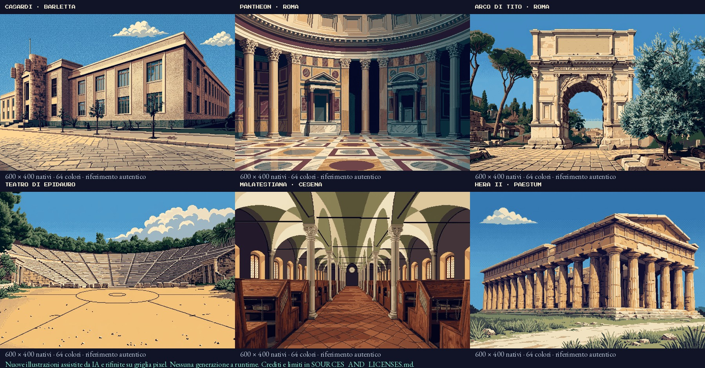

# Cartolina Casardi · v1 · NES Retro 3.1

**Open Day 2026/27 — Liceo Alfredo Casardi, Barletta.** Aggiornamento del 27 novembre 2026.

## Nuova UI, sei scenari completamente rifatti

Interfaccia NES-rétro con titoli pixel, pannelli squadrati, inventario illustrato, colori blu notte/menta/oro e controlli touch. **Tutti e sei i precedenti fondali pixel sono sostituiti**, non soltanto ricolorati: architetture riconoscibili, luce, pavimenti, materiali e profondità dedicati. Le nuove illustrazioni sono **assistite da IA e rifinite a 600 × 400 nativi, 64 colori per sfondo**; provenienza e limiti sono dichiarati, nessun modello viene eseguito nell’app.

**I personaggi modulari LPC già presenti sono mantenuti**, con equipaggiamento fantascientifico e otto companion facoltativi. Preservati entrambi gli stili, creatore completo PC/telefono, PNG reale 3000 × 2000 e **QR temporaneo del PNG già finito**. Il QR del creatore telefono rimane distinto.

Questa consegna è isolata nel **branch `v1`**, cartella **`v1/`**. I file preesistenti del gioco e il branch `main` non vengono modificati. Non rinominare separatamente EXE e HTML.

## Scaricare e avviare

- **[ZIP Windows completo e sorgenti (59,2 MB)](Cartolina_Casardi_Windows_LPC_QR_2026-27.zip)** — usare **Download raw** nella pagina del file.
- [SHA-256 dello ZIP](Cartolina_Casardi_Windows_LPC_QR_2026-27.zip.sha256).
- [Sorgenti e file pronti](casardi_postcard/).
- [HTML autonomo completo](casardi_postcard/Cartolina_Casardi_PC_e_Telefono.html) — scaricare e aprire nel browser.
- [Nuova interfaccia desktop](casardi_postcard/docs/qa/09_interfaccia_nes.jpg) · [telefono](casardi_postcard/docs/qa/10_interfaccia_telefono.jpg).
- [Guida operatore PDF](casardi_postcard/docs/GUIDA_RAPIDA.pdf).

1. Estrarre tutto lo ZIP su Windows x64.
2. Lasciare `AVVIA_CARTOLINA_WINDOWS.exe` e `Cartolina_Casardi_PC_e_Telefono.html` nella stessa cartella.
3. Doppio clic sull’EXE: non servono terminale, Go, Python o Node.
4. Dopo **Genera PNG**, usare il QR **Dal PC al telefono**. PC e telefono devono essere sulla stessa LAN comunicante.

Il solo HTML crea ed esporta offline sul dispositivo, ma **non avvia il server LAN**. In Info il QR distinto apre il creatore telefono completo, non il download del PNG finito.

## Verifiche effettive

La cartella sorgente conserva i **640 file esatti del pacchetto**, compresi sorgenti, EXE/HTML, asset, licenze, guide, report, test, screenshot e campioni. Nessuna credenziale o cartolina visitatore.

45 test unitari; 26 test principali Go con race detector; 6 nuovi sfondi verificati; 7716 casi asset, 6048 layout e 938 confronti esatti sprite. Suite browser: 8 controlli del redesign, 15 servizio, 22 standalone con tutte le 12 esportazioni HD; 16 kiosk Python e altre 12 esportazioni HTTP. Scadenza attesa per **300 secondi reali**. Copia indipendente estratta provata: **506 file runtime identici**, HTML isolato offline, entrambi gli stili 3000 × 2000, QR decodificati, download identici, reset e assenza directory browsing. CRC e manifest SHA-256 completi verificati.

**Limiti:** PE Windows x64 cross-compilato/non firmato; Windows nativo, telefono fisico, Wi-Fi della scuola, Safari/Firefox e Web Share nativo non provati qui. Collaudo IT e sul posto indispensabile. Foto Casardi autentica ma **1936**, non attuale; i colori della nuova illustrazione sono interpretativi. Le architetture illustrate non sono rilievi filologici certificati. Nessun asset di giochi commerciali.

## Documentazione e licenze

- [README completo](casardi_postcard/README.md) · [File unico e telefono](casardi_postcard/docs/GUIDA_FILE_UNICO_E_TELEFONO.md)
- [Report dei test](casardi_postcard/TEST_REPORT.md) · [Matrice effettiva asset](casardi_postcard/ASSET_MATRIX.md)
- [Composizione e appoggi](casardi_postcard/docs/SCENE_COMPOSITION.md) · [Manifest nuovi scenari](casardi_postcard/assets/nes/manifest.json)
- [Fonti e licenze](casardi_postcard/SOURCES_AND_LICENSES.md) · [Crediti LPC](casardi_postcard/assets/characters/CREDITI_LPC.txt)
- [Licenza del codice e ambiti distinti](casardi_postcard/LICENSE)

Codice originale MIT; LPC con licenze per parte (**non tutto CC0**); foto con licenze specifiche; sfondi NES e composizioni come adattamenti CC BY-SA 4.0, mantenendo attribuzioni e obblighi dei riferimenti. Assistenza IA dichiarata; nessuna esclusiva rivendicata sugli elementi generati automaticamente.

**SHA-256 ZIP:** `83699c6701cf4c0afb511da899025439491be7be096e7e81c61f92c59dad0120`.
